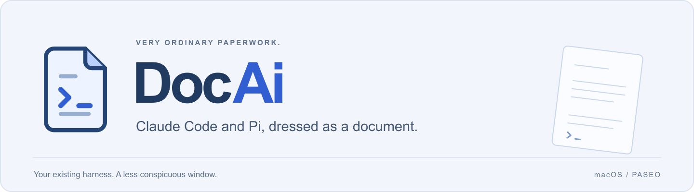
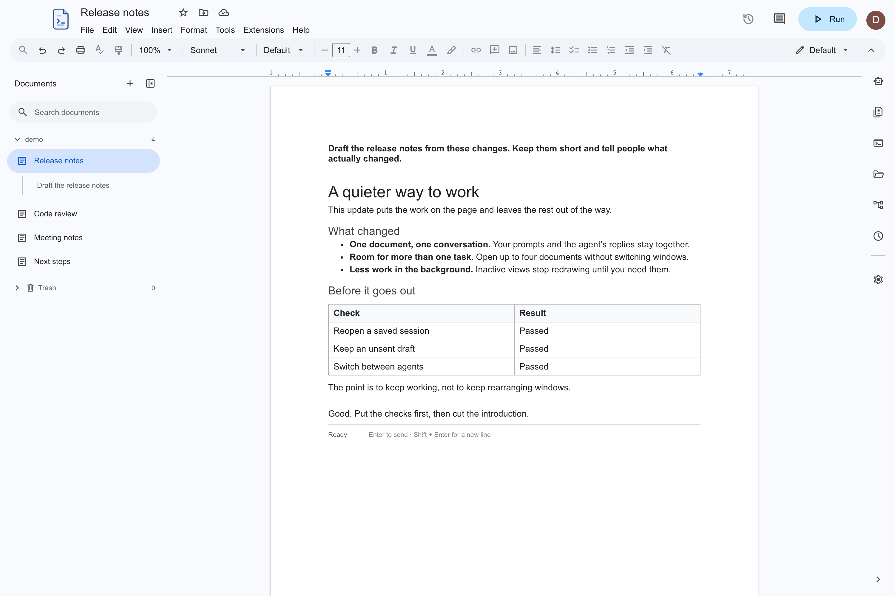
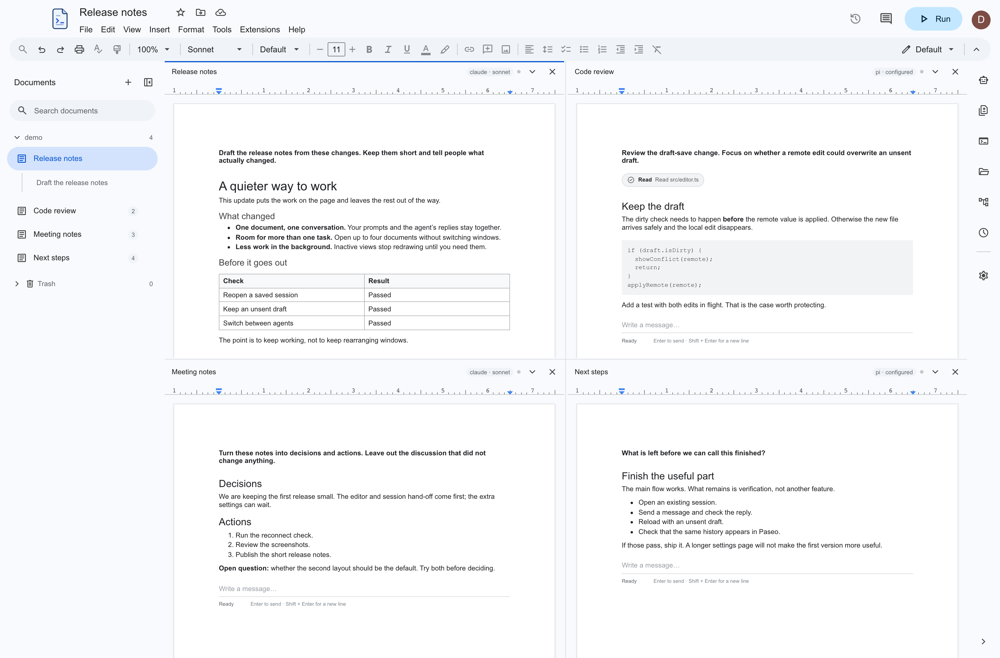

<p align="center">
  
</p>

<p align="center">
  <a href="https://github.com/ammarshah1n/DocAi/actions/workflows/checks.yml"></a>
  &nbsp; · &nbsp;
  <a href="#running-it">Run locally</a>
  &nbsp; · &nbsp;
  <a href="#what-it-does">What it does</a>
  &nbsp; · &nbsp;
  <a href="#a-few-limits">A few limits</a>
</p>

I wanted to use Claude Code and Pi without a terminal making it everybody else's business. DocAi is the result: your agents, in a window that looks like a document editor.

You write on the page, the agent does its work, and the conversation stays in the document. The harness underneath is still the one you chose. There is no reason the window has to announce it.



## What it does

Sessions appear as documents. You can keep one open or work across four, with Claude Code in one pane and Pi in another. Tool calls and reasoning fold away; the actual answer stays on the page.

- Write prompts, paste images and keep unsent drafts across reloads.
- Pin documents and jump back through their prompt outlines.
- Open files, changes, worktrees, terminals and schedules in the side panels when you need them.
- Continue the same Paseo-managed sessions from another client connected to that daemon.

Paseo owns the sessions and history. DocAi is a front end for it, not a replacement agent. This does **not** automatically import every conversation from a standalone terminal: the session needs to be managed by Paseo.



*These are screenshots of the real interface with fabricated demo sessions. Nobody's private conversations are in them.*

## Running it

You need **macOS**, **Node.js 22.19 or newer**, and an installed, authenticated [Claude Code](https://code.claude.com/docs/en/setup) or [Pi](https://pi.dev/). Use your existing provider setup; DocAi does not supply model access.

First, get the local [Paseo daemon](https://paseo.sh/docs) running. If you already use Paseo on this Mac, leave it running—do not start a second copy.

```sh
npm install -g @getpaseo/cli
paseo
```

DocAi connects to `ws://127.0.0.1:6767/ws`. Remote relay access is not needed for this app.

In another terminal:

```sh
git clone https://github.com/ammarshah1n/DocAi.git
cd DocAi
npm ci
npm start
```

To build an Apple Silicon Mac app:

```sh
npm run package
```

The result is `release/DocAi-darwin-arm64/DocAi.app`. This build is not notarised. Intel Mac, Windows and Linux packages are not currently tested or supplied.

For development:

```sh
npm run dev        # Vite and Electron
npm run typecheck
npm test
npm run build
```

## A few limits

The document is a conversation view, not a full word processor. Some familiar toolbar controls are deliberately disabled rather than pretending to work.

Session history lives in Paseo; layouts, pins and drafts stay local to DocAi. File saves check revisions and protect unsaved edits, although automatic file-change notifications can sometimes lag. Schedule, project and workspace updates do not have the same atomic conflict guarantee, so exact simultaneous edits can still collide.

The renderer uses continuous paper rather than measuring and splitting pages after every streamed update. In local synthetic tests, that cut streaming-render CPU work by roughly two-thirds. It is not a promise about your battery life.

The app runs locally, but your chosen provider still handles model requests under its own terms. Looking discreet is not a privacy or security guarantee.

## Built on

[Paseo](https://github.com/getpaseo/paseo) does the agent orchestration. The interface uses [Electron](https://www.electronjs.org/), [React](https://react.dev/), [Streamdown](https://github.com/vercel/streamdown), [xterm.js](https://xtermjs.org/) and [Material Symbols](https://fonts.google.com/icons). The Paseo client SDK is pinned to `0.10.3`; its internal APIs are version-sensitive.

[Third-party notices](THIRD_PARTY_NOTICES.md) cover the dependencies, not DocAi's own source. No project licence has been selected yet.

DocAi is an independent project. It is not affiliated with Google, Anthropic or the Pi maintainers.
